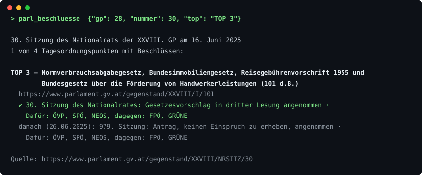

# parlament-at-mcp

[](https://github.com/bernhardbrugger/parlament-at-mcp/actions/workflows/ci.yml)


MCP server for the **Austrian Parliament** (Nationalrat and Bundesrat). Ask an LLM who sits where, which committee a bill is in, what was asked and answered, and **what a politician actually said** in the plenary - with a link to the official source for every result.

> **Status: v0.5, beta.** Twelve tools, six prompts, 440+ offline tests (97 % line, 86 % branch coverage), verified against the live interface. Unofficial; not affiliated with the Parlamentsdirektion.

## Why this exists

- **Single speeches, not 300,000-character protocols.** The Parliament publishes every speech as its own segment. `parl_sitzung` lists the agenda items and _every speaker_, `parl_rede` returns one speech as text (interjections optional) in pieces of at most 45,000 characters, with `offset` paging.
- **Who asked, who answered, how did it go.** Inquiries with the party of the introducer, bills with their procedure through committee, Nationalrat and Bundesrat, the vote by party and the Bundesgesetzblatt link.
- **Who is in office _now_.** Current Nationalrat and Bundesrat members are marked with club, constituency and state and can be filtered; every person has a biography page and a list of all their plenary speeches.
- **Built for LLMs:** German tool texts with source links, `structuredContent` + `outputSchema` on the list tools, six ready-made research prompts (including a fact-check workflow), size-bounded output. `kompakt=true` on the list tools gives one line per hit (measured on 50-hit lists: 34-50 % less text, links kept).
- **Honest about an undocumented interface.** The Parliament documents no endpoints. Everything here was measured and is written down in [`DECISIONS.md`](DECISIONS.md); a live canary suite tells you when the interface changes.

## Tools

| Tool                | What it does                                                                                                                                                        |
| ------------------- | ------------------------------------------------------------------------------------------------------------------------------------------------------------------- |
| `parl_abgeordnete`  | Find people by name, body, function; current members are marked and filterable (`nur_aktuell`, `klub`, `bundesland`)                                                |
| `parl_person`       | Biography and mandates of one person with dates, club, career, education                                                                                            |
| `parl_reden_person` | All plenary speeches of one person, newest first, with session and topic                                                                                            |
| `parl_anfragen`     | Inquiries or answers, newest first; filter by body, legislative period, search term                                                                                 |
| `parl_gegenstaende` | List bills (Regierungsvorlagen), motions (Anträge), referendums, petitions, citizens' initiatives and EU documents by period and keyword                            |
| `parl_gegenstand`   | One item in detail: introducer/answerer with party, procedure, vote, Bundesgesetzblatt, PDFs, references                                                            |
| `parl_sitzungen`    | List plenary sessions of the Nationalrat and the Bundesrat                                                                                                          |
| `parl_sitzung`      | Outline of one session: agenda items with times and every speaker; filter by speaker or agenda item                                                                 |
| `parl_rede`         | One speech as text, in citable pieces                                                                                                                               |
| `parl_suche`        | **Full-text search** of all plenary speeches (and press releases, items): exact phrases, speaker, period, date range; every hit names the arguments for `parl_rede` |
| `parl_beschluesse`  | What a session decided per agenda item, with the vote by party and later steps (e.g. Bundesrat); press releases, agenda links                                       |
| `parl_ausschuesse`  | Committees of a period; with `suche=` also chairs (with party), tasks, latest agendas, assigned items                                                               |

**Prompts:** `faktencheck`, `rede_recherchieren`, `gesetz_verfolgen`, `anfragen_zum_thema`, `ausschuss_ueberblick`, `abgeordnete_profil` - each chains the tools above for one research task.

Real output (from a live run, not mocked):



Example questions (all answered from live data during development):

- _"Hat Herbert Kickl im Nationalrat wirklich gesagt, ...?"_ → `parl_suche` (`modus="phrase"`, `redner="Kickl"`) → `parl_rede` with the paragraph number → `parl_beschluesse` for the vote (the `faktencheck` prompt does this chain)
- _"Was hat Herbert Kickl in der 30. Sitzung der XXVIII. GP zum Budgetbegleitgesetz gesagt?"_ → `parl_sitzung` (`redner="Kickl"`) → `parl_rede`
- _"Was hat der Nationalrat am 15. Oktober 2026 beschlossen und wie haben die Parteien abgestimmt?"_ → `parl_beschluesse`
- _"Wo steht die Regierungsvorlage 251 d.B. im Verfahren?"_ → procedure per phase, vote _Dafür: F, V, S, N, G, Dagegen: -_, Bundesgesetzblatt I Nr. 86/2025
- _"Wer ist Obmann des Finanzausschusses und was steht auf der Tagesordnung?"_ → `parl_ausschuesse` with `suche="Finanzausschuss"`
- _"Wer sitzt für die Grünen aus Wien im Nationalrat?"_ → `parl_abgeordnete` with `klub`, `bundesland`
- _"Welche Anfragen zum Polizeischutz gab es, und wer hat sie gestellt?"_ → `parl_anfragen` → `parl_gegenstand`

A speech, as the server returns it (shortened):

```
Herbert Kickl (FPÖ) · 11.12–11.32
30. Sitzung des Nationalrats der XXVIII. GP am 16. Juni 2025 · TOP 2-4 Debatte zum Budgetbegleitgesetz 2025
Quelle: https://www.parlament.gv.at/dokument/XXVIII/NRSITZ/30/A_-_11_12_46_00801352.html
45 Absätze, in eckigen Klammern nummeriert (mit Zwischenrufen gezählt); zum Zitieren die Nummer angeben, gezielt abrufbar mit absaetze="5-9".

[1] Abgeordneter Herbert Kickl (FPÖ): Danke schön, Herr Präsident! […] (Beifall bei der FPÖ. – Abg. Michael Hammer [ÖVP]: Na bravo!)

[Zeichen 1–857 von 21859; weiterlesen mit offset=857]
```

## Install

Needs Node 20 or newer. No API key, no account: the server only talks to `www.parlament.gv.at`.

### With npx (recommended)

Every client starts the server with the same command, `npx -y parlament-at-mcp`; only the place of the configuration differs. Restart the client after changing its configuration.

**Claude Desktop** (Settings → Developer → Edit config; `%APPDATA%\Claude\claude_desktop_config.json` on Windows, `~/Library/Application Support/Claude/claude_desktop_config.json` on macOS)

```json
{ "mcpServers": { "parlament-at": { "command": "npx", "args": ["-y", "parlament-at-mcp"] } } }
```

**Claude Code**

```bash
claude mcp add parlament-at -- npx -y parlament-at-mcp
```

**VS Code (GitHub Copilot)**: `.vscode/mcp.json` in your project

```json
{ "servers": { "parlament-at": { "type": "stdio", "command": "npx", "args": ["-y", "parlament-at-mcp"] } } }
```

**Cursor**: `.cursor/mcp.json` in your project, or `~/.cursor/mcp.json` for all projects

```json
{ "mcpServers": { "parlament-at": { "command": "npx", "args": ["-y", "parlament-at-mcp"] } } }
```

**Windsurf**: `~/.codeium/windsurf/mcp_config.json`

```json
{ "mcpServers": { "parlament-at": { "command": "npx", "args": ["-y", "parlament-at-mcp"] } } }
```

**Any other MCP client** that speaks stdio: run `npx -y parlament-at-mcp`.

> **Windows:** if a client cannot find `npx`, start it through the shell instead: `"command": "cmd", "args": ["/c", "npx", "-y", "parlament-at-mcp"]` (this variant was tested).
>
> **What was tested:** the `npx` command itself (installed from the packed archive on Windows, started directly and through `cmd /c`, with a live search), and Claude Desktop and Claude Code with a local build. The snippets for VS Code, Cursor and Windsurf follow those programs' documented configuration formats but have not been tried; please open an issue if one does not work.

Try it with: _"Welche Regierungsvorlagen hat der Nationalrat zuletzt beschlossen, und wie haben die Parteien abgestimmt?"_ or _"Hat jemand im Nationalrat den Satz 'Ich rede vom Staatsbesuch' gesagt? Wer, wann, in welcher Sitzung? Zitiere mit Absatznummer."_

### From source (development)

```bash
git clone https://github.com/bernhardbrugger/parlament-at-mcp.git
cd parlament-at-mcp
npm install && npm run build
```

Then point the client at the built file instead of npx, e.g. for Claude Desktop `{ "mcpServers": { "parlament-at": { "command": "node", "args": ["/absolute/path/to/parlament-at-mcp/dist/index.js"] } } }` (on Windows with doubled backslashes: `"C:\\Users\\you\\parlament-at-mcp\\dist\\index.js"`). After a rebuild, restart the client: it keeps running the version it started with.

**Remote (Streamable HTTP, stateless)**

```bash
PORT=3000 npm run start:http        # POST http://127.0.0.1:3000/mcp, health: GET /healthz
```

The HTTP mode is tested (in-process and with the built server over curl). **Docker is experimental:** the repository contains a `Dockerfile`, but it has never been built or run, so treat it as a starting point and please report problems.

The HTTP mode has no authentication and no rate limiting. Put a reverse proxy with TLS, authentication and rate limiting in front before exposing it; see [`SECURITY.md`](SECURITY.md).

## Limitations, data and licence

- Source: open data of the Austrian Parliament, **CC BY 4.0**. Attribution: _Quelle: Parlamentsdirektion_. See the [Parliament's open data page](https://www.parlament.gv.at/recherchieren/open-data/).
- The interface is the website's own JSON API. It is **not formally documented** and may change without notice. This server records what it measured in [`DECISIONS.md`](DECISIONS.md).
- Newer stenographic protocols were produced with AI support and then edited by the Parliament (the server passes that note on). Biographies are, from 1945, based on the members' own statements.
- Counts without a legislative period are capped by the interface at about 20,000. `parl_gegenstaende` searches the _official keywords_ of bills; use `parl_suche` for full text. `parl_suche` finds that something was said, never whether it is true: fact-checking needs a second source, and the `redner` filter only looks at the first 300 hits of a search.
- The client waits one second between requests and caches large lists (persons 6 h, current members 1 h, sessions 10 min).
- Results are official information, not legal or political advice. Only office holders and officials as published by the Parliament; no profiling of private persons.

## Development

```bash
npm run check             # typecheck + lint + format check + offline tests
npm run test:coverage     # coverage report
npm run build && npm run smoke:live     # every tool once against the real interface
npm run test:integration  # live canary: do all lists and pages still have the expected shape?
```

See [`CONTRIBUTING.md`](CONTRIBUTING.md) for the working rules (measure first, test from real responses, check live) and [`SPEC.md`](SPEC.md) for the design notes and scope.

## License

MIT - see [LICENSE](LICENSE). Data: CC BY 4.0, Parlamentsdirektion.
